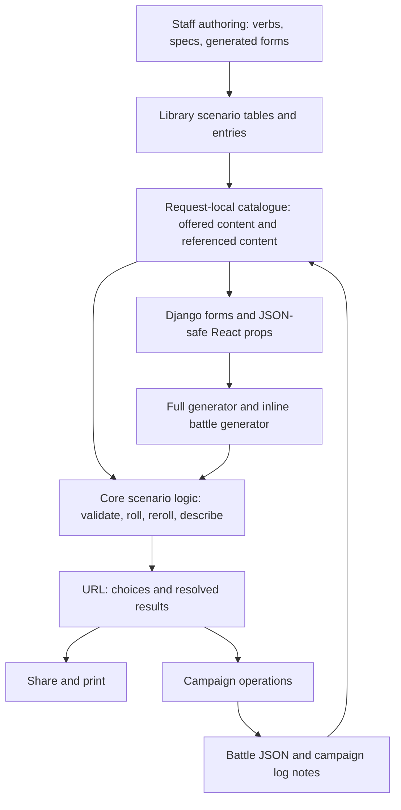

# Author-editable N26 scenario tables

Proposal based on `bc570a0eb` (merged PR #3019), 4 November 2026.
The first milestone implements the shared catalogue and authoring described here.
Generator definitions and broader generalisation remain follow-up work.

## Recommendation

Move the seven existing scenario tables into the N26 content library. Staff
should edit their names, entry names, descriptions and deployment diagrams in
the existing authoring surface, and create additional side-job sets there.
Changing that content must require neither a code change nor a deployment.

Start with the current generator: Deployment, Objective and Crew, plus up to six
side jobs. Preserve its dependent dropdowns, sharing, printing and battle flows.
Generalise the content representation now. Make the composition of generators
editable in a later increment, when there is a second generator to describe.

Here, an author means a staff member using `/n26/authoring/`. Campaign
arbitrators creating their own content are a later permission and product flow.

## What exists and what it connects to

`n26/library/scenario_tables.py` contains three primary tables and four side-job
sets: General, Escher, Goliath and Orlock. All seven have six D6 entries: 42
entries in total. Each has a number, name and description; Deployment also has
six static PNG diagrams. Asterisks in descriptions represent bold text.

`n26/core/scenarios.py` rolls, parses, rerolls and describes those constants.
`ScenarioGeneratorForm` builds the menus and validates selections. The forms
and `views/scenario_props.py` supply the same choices to the full generator and
inline battle generator. The React islands already consume data rather than
importing a parallel content catalogue, which makes them a useful migration
boundary.

The results are used by all of these surfaces:

- The standalone generator at `/n26/scenario/` and the campaign generator.
- Inline generation on battle creation and on saved battles.
- Per-side-job reroll dialogs, including avoidance of already selected jobs.
- Share links, print pages and links back from saved scenarios.
- Saving a named scenario to the campaign log.
- Creating a battle or attaching a scenario to an existing battle.
- Battle summaries and campaign history descriptions.

`Battle.scenario_rolls` stores JSON such as
`{"deployment": 2, "side_job": "escher-3"}`. A campaign log event stores the
same references inside a compact text note. They do **not** store the wording.
Both are resolved against the current content when displayed. Legacy bare
side-job numbers refer to General. Side-job component keys identify the slot
(`side_job`, `side_job_2`, ...), not the table it uses.

## Content model for the first increment

Use one `ScenarioTable` model and one `ScenarioEntry` model, both based on
`library.Content`. These are descriptive content, not assignables carried by a
gang. Do not add Assignment fields, prices, ratings or modifier wiring.

A table has:

- A purpose: Deployment, Objective, Crew or Side jobs. These describe how the
  current generator uses the table; they are a small, deliberate code contract.
- Its editable display name, and its position in the side-job menu.
- Its inherited pack, staging and archive fields.
- An immutable external identity. Keep the existing keys as read-only legacy
  aliases; use the inherited ULID for new tables. Display names are not keys.

An entry has:

- Its table, D6 result number, editable name and description.
- An optional diagram, diagram alternative text and display position if needed.
- Its inherited content identity and lifecycle fields, with the same pack as its
  table. Release the table and its entries as one complete set.

Constrain one entry per `(table, roll)` and a roll from 1 through 6. Require a
nonblank name and description before release. Only one primary table of each
purpose is supported per pack in this increment; side-job tables are repeatable.
The player generator uses the default pack. Staff can add another side-job set
without extending an enum or registering its name in code.

Do not expose a form for an alternative primary table that the current player
flow cannot select. Other packs and alternative primary tables become useful
with generator definitions in the second increment.

D6 is an intentional first-release restriction. The schema need not pretend to
support other dice while forms, result encoding and diagrams still assume six
single-number outcomes. A later range table needs stable entry references,
not just a bigger numeric field.

## Author workflow

Add **Scenario tables** to the existing authoring navigation. Its list shows the
three primary tables and all side-job sets. A table's detail page shows its
entries in roll order, a coverage summary and a link to preview it in the real
generator. Editing an entry changes its name, description and optional diagram.

Creating a side-job set creates a staged table. The author adds six entries,
checks the real generator preview, then puts the complete table live. The new
set appears in both generators and reroll dialogs automatically. Incomplete
tables remain visible in authoring with a clear coverage error; even staff
cannot roll an incomplete table.

Follow the existing library pipeline:
`models -> authoring verbs -> specs -> generated forms -> view registries`.
Add `create_scenario_table` and `add_scenario_entry` verbs. Use the existing
`revise` path for editable fields, with explicit model-specific validation and
identity protections. Register the table in `LEAF_KINDS`, its entries in
`DETAIL_KINDS`, and add descriptions, listing hints and parent-aware entry
forms. Keep table and purpose fixed on entry editing.

Staging requires deliberate work: new models are discovered by `content_kinds`,
but are **not** automatically included by `stageable_kinds`. Also, `put_live`
currently just clears a flag, and `put_everything_live` performs bulk updates.
Both individual and bulk release paths must validate the complete effective
scenario table and release its entries atomically. A validation rule only on
the detail-page button is insufficient.

Keep the existing staging semantics: new content can be held back; edits to
already live content become live immediately. State that clearly on the edit
page. Draft revisions of live content would be a separate feature.

Retain the small text-formatting contract initially: plain text with the
existing emphasis convention, rendered safely in Django and React. This avoids
introducing a second HTML transport into the islands. Richer formatting can be
an independent decision later.

Diagrams must be editable too. Preserve the six static diagrams through the
migration, and provide a site-storage upload for replacements with alternative
text. The existing `Artwork` spec is SVG-only, whereas these maps are PNGs:
reuse the storage platform seam but add a suitable raster-image form/spec
adapter. Do not silently restrict authors to committing static files or repurpose
the gang-icon upload directory. Keep legacy static references and uploaded
storage references explicit in one diagram resolver.

## Reading, validation and performance

Introduce a library reader that loads a scenario catalogue into plain immutable
display objects. Preserve the useful current dataclass methods (`label`, `parts`,
`plain`, `entry`) at this boundary. Avoid calling ORM queries from each helper.

Pass the catalogue into `parse`, `roll`, `read_side_job`, `reroll_side_job`,
forms and prop builders. This gives a request one coherent set of content,
keeps scenario computation testable, and removes imports of `TABLES` and
`SIDE_JOB_SETS` from consumers. Keep slot names, side-job limits and random
selection policy in core: those are behaviour, not authored rules text.

The catalogue has two distinct read policies:

1. **Offered content**, used for new choices and writes: default-pack,
   unarchived content, including staged content only for `sees_staged(actor)`.
   Check complete tables and apply the same policy in the server operation,
   not only in the browser or form.
2. **Referenced content**, used to display saved results and known result
   links: retain archived and staged references, as library subscriber reads
   already do. Retiring a table removes it from new menus without erasing
   existing battles or log entries. Staging is a discovery gate, not secrecy.

Changing an old battle's other fields must not turn its retained scenario into
a newly offered selection. New generation or attachment validates current
eligibility; reading or retaining an existing result resolves its references.
Unknown or malformed references remain an error, never silently omitted.

Load tables and entries in a bounded number of queries (normally one for each,
plus existing permission work). Pass one catalogue through the whole page.
Campaign history currently describes each event separately; loading a catalogue
inside each `results()` call would create a query per history event. Batch the
load at the history-reader boundary as well as the generator boundary. Add
query-growth tests for both, rather than promising the old zero-content-query
count.

## Compatibility and lifecycle

Preserve all current URL keys, side-job slot keys and compact stored values.
Resolve old aliases (`general`, `escher`, ...) as well as new ULID-based set
identities. Keep the final-hyphen parsing rule and legacy bare General rolls.
Do not rewrite battles or historical log notes just to replace constants with
content records.

Published table aliases, table purposes and entry roll identities are immutable.
Authors can correct names, wording and diagrams; existing results display the
correction, matching current behaviour. A substantial change to what a result
means should use a new set/table identity. Renumbering must never silently
reassign an old result to a different entry.

Keep historical fidelity as an explicit product choice. This proposal preserves
**current wording**, not a snapshot of the rules used on battle day. If exact
historical wording is required, add content revisions and pin result entries
to a revision before permitting semantic replacement. Timestamps alone cannot
reconstruct that wording.

Generic library deletion discovers database relationships. It cannot see
references embedded in battle JSON, event text or external shared URLs. Do not
rely on `on_delete=PROTECT` alone: exclude these models from hard deletion in
authoring, bulk staged deletion and the delete verb. Offer table retirement
instead. Active primary tables cannot be retired while the current generator
requires them. Do not offer independent entry retirement that leaves a live
D6 table incomplete.

## Generalisation: what to reuse and what to add later

The library already has `Dice`, `band_problem` and `band_coverage`. Those are
shared, pure mechanics and should remain the canonical implementation. For
single-face scenario entries, a small adapter can present identical low/high
bounds to coverage validation. Move those helpers out of `models/slots.py`
only if their growing use makes that organisation worthwhile.

`Picklist` selects `Pickable` objects for slots and assignments. `AssetTable`
selects assets a campaign gains. A scenario entry is a description of play.
Reusing either model wholesale would attach irrelevant acquisition concepts
to it. Reuse mechanics and the authoring UI patterns, keeping result types and
write behaviour explicit. No universal table with arbitrary JSON effects,
generic foreign keys or executable authored expressions is needed.

The next useful abstraction is **generator composition**:

- An authored `ScenarioGenerator` names and describes a generator.
- Its components identify stable roles, labels, order and the table used for
  each role; they state whether a part is optional or repeatable.
- A repeatable side-job component lists its allowed tables and repeat limit.
- A campaign type can nominate a default generator; a campaign may later
  choose its own. The standalone generator has an explicit system default.
- Generator selection and resolved table/entry identities travel through URL,
  battle and log encoding together. Add a versioned encoding with legacy
  decoding before introducing multiple Deployment tables or roll bands.

That supports another complete generator, alternate Deployment tables or an
extra Battlefield conditions component without new form branches. It does not
try to interpret written victory conditions or automatically award rewards.

Only when a real table needs it, add D3/D66/2D6, range entries and dice-aware
controls using existing `Dice`. Keep actual dice probabilities: a 2D6 table is
not a uniform choice of totals. Duplicate avoidance must exclude entry identity
rather than merely roll total, terminate when all entries are used and preserve
explicit player choices. The current rejection-sampling policy can otherwise
remain. Automated scenario rewards would connect through named core operations,
not code embedded in descriptions.

Campaign-owned content is another extension: reuse `Campaign.pack`, the current
arbitrator permissions and explicit pack selection. Packs organise discovery;
they do not by themselves define who can read a saved battle or shared result.
Spreadsheet ingest is optional later work: use the existing preview-plan-perform
pipeline and authoring verbs when authoring volume warrants it.

## Delivery sequence

1. **Library schema and original-content transfer.** Add the two models and
   constraints, generate one library migration leaf and transfer exactly seven
   tables/42 entries with unchanged aliases, roll numbers and diagram references.
   Freeze that migration's input; do not import mutable runtime constants from
   an old migration. Test fresh installs and upgrades. A rerunnable bootstrap,
   if provided, creates missing original records only and never overwrites
   authored wording. This is starter content, not `standard_content` that the
   application owns indefinitely.
2. **Replace runtime constants.** Add the catalogue, thread it through forms,
   core scenario helpers, operations, props, printing and history. Preserve
   externally visible behaviour and legacy data. Remove the constants from
   runtime use rather than retaining a silent fallback source of truth.
3. **Complete authoring.** Add the registry/spec integration, safe editing,
   preview, complete-table release, retirement and diagram upload. Prove a
   newly authored side-job set reaches full generator, inline generator and
   reroll without a code edit. Update concepts, staged-content guidance,
   recipes and scenario developer documentation.
4. **Generalise composition when needed.** Deliver generator definitions,
   explicit selection, campaign defaults and versioned stable result references.
   Add other dice, ranges, homebrew permissions or ingest as separate increments
   justified by actual content.

Steps 1–3 are one complete author-editability milestone. They can be reviewed
as a stack, but users should receive a working authoring-to-player flow before
this work is declared finished.

## Acceptance checks

- An author edits an existing name, description and deployment diagram; all
  player renderers show the update without a deployment.
- An author creates a six-entry side-job set, previews it while staged and puts
  it live. Ordinary players only discover it after release. Forms, islands,
  reroll, print and sharing all use the same content.
- Missing/duplicate/out-of-range entries cannot be released by either individual
  or bulk actions. Invalid server submissions write nothing.
- Every previous URL, battle JSON and log note still resolves, including bare
  General rolls, sparse side-job slots and hyphenated legacy keys.
- Retirement removes a set from new choices but preserves saved results and
  known result links. Every hard-delete surface enforces the same rule.
- A no-op bootstrap never overwrites an author's changes. Fresh migration and
  realistic database upgrade both succeed without rewriting player data.
- Content query counts stay flat from one to six side jobs and from one to many
  scenario history events. Browser checks cover both generator variants,
  dependent dropdowns, Back/Forward, reload, generation, attachment, share,
  print, permissions and light/dark mobile layouts.

## Main source locations

- `n26/library/scenario_tables.py`: current content, aliases and display helpers.
- `n26/library/models/base.py`, `pack.py`, `slots.py`: lifecycle, packs and dice.
- `n26/library/authoring.py`, `specs.py`, `forms.py`, `views.py`: authoring pipeline.
- `n26/library/staged.py`, `deletion.py`, `references.py`: lifecycle integration.
- `n26/core/scenarios.py`, `forms.py`, `campaigns.py`: scenario logic and writes.
- `n26/core/views/scenarios.py`, `campaigns.py`, `battles.py`, `scenario_props.py`.
- `n26/core/history.py`, `models/campaign.py`: persisted references and history.
- `n26/frontend/scenarios/` and the scenario/battle island directories.
- `n26/tests/test_views_*scenario*.py`, `n26/core/test_scenarios.py` and
  `n26/library/test_scenario_tables.py`: existing regression coverage.
