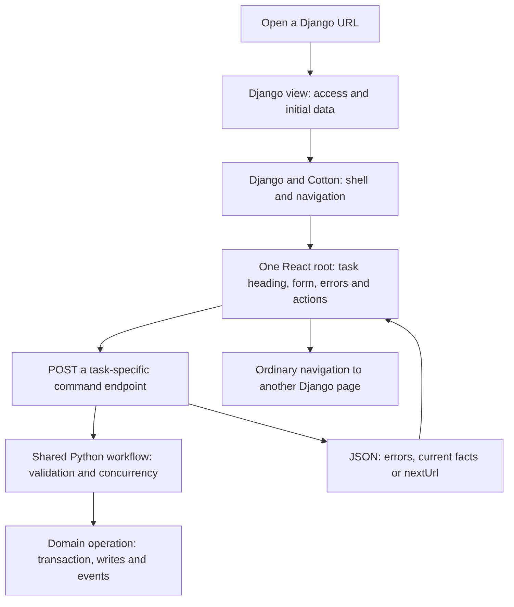
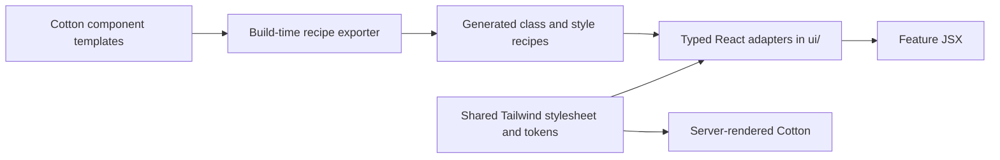

# How React workflows fit into N26

Django owns routes, access and business rules. React owns an independent
interaction or a complete task inside a Django page. Manage credits, Edit
campaign holding and Edit campaign asset type show the complete-task pattern.
The shared page shell and navigation continue to use Django and Cotton.

This guide follows those implementations through the codebase. Code snippets
are shortened unless described as complete. The [migration plan](react.md)
defines parity checks, migration order and when to defer a conversion.

## Follow one request



The boundary follows the task: its inputs, mutable figures, confirmations and
failure states have one React owner. Independent shared navigation stays outside
that root. Moving to another task uses an ordinary link; no client-side router
is required.

## Find the code

Manage credits has this structure:

```text
n26/
├── core/
│   ├── credits.py                         # Shared workflow and display data
│   ├── forms.py                           # Django validation
│   ├── views/credits.py                   # HTML and JSON HTTP adapters
│   └── templates/n26/gang_credits.html     # Shell and React mount
├── frontend/
│   ├── islands/manage-credits/
│   │   ├── entry.tsx                      # Public mount function
│   │   ├── ManageCredits.tsx              # Feature UI and response handling
│   │   └── ManageCredits.test.tsx
│   ├── ui/
│   │   ├── index.tsx                      # Public design components
│   │   └── useWorkflowForm.ts             # Save and recovery lifecycle
│   └── http/command.ts                    # HTTP transport
└── urls.py                                # Page and command routes
```

The other complete forms use the same infrastructure. These paths are relative
to `n26/`:

| Task | Shared Python workflow | HTTP adapters | React island |
| --- | --- | --- | --- |
| Manage credits | `core/credits.py` | `core/views/credits.py` | `manage-credits` |
| Edit campaign holding | `core/asset_edit.py` | `core/views/campaign_assets.py` | `edit-holding` |
| Edit campaign asset type | `core/asset_type_edit.py` | `core/views/asset_types.py` | `edit-asset-type` |

An island may import shared UI, transport and runtime modules. It does not
import another island's entry point. Compose reusable components within the
task's root.

## Cross the Django-to-React boundary

The [Manage credits template](../../n26/core/templates/n26/gang_credits.html)
extends the existing layout, keeps its navigation blocks and mounts the form:

```django




    

```

The [view](../../n26/core/views/credits.py) prepares plain display data: gang name
and balance, choices, field values and errors, server-generated URLs, a CSRF
token and a recovery-storage key scoped to the actor and task. ORM objects do
not cross this boundary. Form values have this shape:

```json
{
  "direction": "add",
  "amount": "",
  "note": "",
  "request_key": "a-server-generated-UUID"
}
```

The `react_island` tag safely embeds props using Django's JSON escaping and
loads the built entry and its dependencies. React receives initial facts without
fetching them again. Add a read endpoint only when the task needs a later
refresh or lazy data.

React owns every child of its host. The host sets `x-ignore` and `hx-disable`
so Alpine and htmx cannot alter those children. Do not nest another island or
move server-rendered nodes into the root. An island inside an externally swapped
region must use the shared mount/disposal lifecycle.

The complete `entry.tsx` is small:

```tsx
import { mount as mountRoot } from "../../runtime/mount";
import { ManageCredits, type ManageCreditsProps } from "./ManageCredits";

export function mount(element: HTMLElement, props: ManageCreditsProps) {
    return mountRoot(element, ManageCredits, props);
}
```

The runtime returns a disposer. Vite discovers island entry files; the Django
tag resolves the matching name through its build manifest. No feature registry
needs updating.

## Keep endpoints narrow and behaviour shared

Manage credits uses these routes:

| Request | Purpose |
| --- | --- |
| `GET /n26/gangs/<id>/credits/` | Render the shell and initial React props |
| `POST /n26/gangs/<id>/credits/` | Accept a conventional form submission |
| `POST /n26/gangs/<id>/credits/change/` | Accept React's command and return JSON |

The React request is form encoded and uses same-origin session and CSRF
protections. The response is JSON. Python supplies the endpoint URLs.

Both POST adapters call the same workflow function. Their essential structure is:

```python
# Conventional POST adapter
result = credits.change(gang, request.user, request.POST)
if result.saved:
    _feedback(request, gang, result)
    return redirect(back)
# Otherwise render props with the form errors.
```

```python
# JSON command adapter
result = credits.change(gang, request.user, request.POST)
if result.saved:
    _feedback(request, gang, result)
    return JsonResponse({"nextUrl": back})
return JsonResponse(
    {"errors": dict(result.form.errors), "balance": gang.credits},
    status=409 if result.conflict else 422,
)
```

The adapters also check authentication and access and validate return URLs; those
steps are omitted above. Manage credits returns `200` for a saved adjustment or
confirmed matching replay, `422` for validation or business-rule refusal, and
`409` for conflicting key reuse. Sign-in, CSRF and access failures use `401`,
`403` and `404` respectively.

These page bodies currently require JavaScript. Retaining a conventional POST
contract does not provide a second server-rendered form when JavaScript is
disabled. The `react_island` host displays loading and no-JavaScript messages.

The shared Python workflow validates the Django form, enters the existing
operation boundary, rechecks permission under the lock and applies or recognises
the command:

```text
credits.change(gang, user, data)
  → validate CreditsForm
  → enter operation(gang, actor=user)
  → recheck current permission
  → find a ledger receipt for request_key
  → compare a replay's actor and business input, or apply the adjustment
  → return form errors or a saved result
```

HTTP adapters own response formats, safe return navigation, feedback and
analytics. The workflow and operation own the action's meaning and effects.
Calling the same low-level operation from two views is insufficient if they
still duplicate validation, permissions or selection rules.

An arrival page restored by the back-forward cache must refresh current server
facts and its updated stored handoff, even if its mounted React instance never
submitted a command. Freeze the cached controls while refreshing; do not save
its stale selections over a nested picker's newer answer or an unknown command.

Retain an unknown picker's original command endpoint as well as its exact body
and key. Validate the same-origin owned path and bounded presentation context
before retrying with fresh CSRF. Older receipts can bridge ordinary and campaign
entry only when actor, choice, business input and return destination match.

## Write feature code as a form

[ManageCredits.tsx](../../n26/frontend/islands/manage-credits/ManageCredits.tsx)
imports its controller and design components from `../../ui`. An amount field
looks like this, with the currency suffix omitted:

```tsx
<Field
    label="Credits *"
    htmlFor="credits-amount"
    errors={form.errors.amount}
>
    <Input
        name="amount"
        type="number"
        min="1"
        required
        value={form.values.amount}
        onChange={(event) =>
            form.setValues({ ...form.values, amount: event.target.value })
        }
    />
</Field>
```

`WorkflowPage` renders a native form with the task heading, breadcrumbs, actions
and footer. Inputs retain their `name` attributes so the controller can read
normal form data. A disabled fieldset freezes the draft during pending or
unresolved saves. The submit button offers Save, Saving… or Retry save according
to the controller's state.

## Share the lifecycle, keep command meaning local

The three forms share [useWorkflowForm](../../n26/frontend/ui/useWorkflowForm.ts).
Its responsibilities are separate from the server's retry guarantees:

| Concern | Owner |
| --- | --- |
| Pending state, frozen inputs and error-summary focus | `useWorkflowForm` |
| Retaining unresolved business input across reload | `useWorkflowForm` |
| Navigation warnings and history restoration | `useWorkflowForm` |
| Session credentials, CSRF and unreadable/network responses | `http/command.ts` |
| Meaning of a successful or conflicting response | Feature component |
| Whether a repeated command can write again | Python workflow and database |

The feature supplies `interpret(status, data)`. It validates the response shape
and returns `saved`, `invalid` or `conflict`. An unrecognised response leaves the
write unconfirmed.

An uncertain save retains its exact business input before sending, freezes
editing and offers a retry. Reload uses fresh credentials with the retained
input; CSRF tokens are never stored with it. A rejected retry cannot establish
whether an earlier request committed.

A frozen recovery view needs a readable snapshot of the submitted draft. Synchronise it before sending, alongside the command intent; initial props may describe another draft. Keep display labels separate from the exact raw body and request key used for retries.

Test names, roles, equipment and counts immediately after a lost response and again after reload. A newer saved state must not replace that submitted snapshot.

After receipt and key checks, compare a valid submitted revision with the locked revision before returning mutable roster errors. Keep errors for filtered-out models visible in a labelled summary so the reader can resolve them.

A changed roster or removed equipment set can make an old command invalid without changing the crew revision. Record that no-write result under the same locks before resolving uncertainty. An explicit reload can then keep the rejected selections under a new key and add current unselected defaults; generic validation errors must retain the original uncertain body. Keep a removed set’s original value and readable name until the reader explicitly chooses a current set.

The server's retry contract depends on the action:

| Action | Contract |
| --- | --- |
| Add or remove credits | A durable request key identifies an adjustment. A matching replay succeeds without a second ledger event. |
| Edit holding or asset type | Compare a signed starting state under the lock. Matching desired values succeed without another write; a stale different edit requires review. |

An absolute-edit conflict returns `code: revision_conflict` and current facts.
React shows them beside the frozen draft and offers an explicit Review action
to load a fresh baseline. The controller cannot infer that meaning from HTTP
409 alone: a credits key refusal does not resolve an uncertain adjustment.

Asset type editing also signs whether ownership was initially locked. Related
assets or tables can change that constraint without updating the type's
modification timestamp. The command checks that derived constraint under the
lock before accepting the edit.

## Use the design library through React adapters



Features use the public adapters:

```tsx
<Button type="submit" variant="success">Save</Button>
<Input name="note" value={value} onChange={onChange} />
```

The adapter renders native elements using presentation recipes extracted from
Cotton at build time. The Button adapter applies `recipe[variant]` to a native
`<button>`. Cotton remains the styling source; React implements state, behaviour
and accessibility.

Do not render `<c-ui.button>` in JSX, copy long Cotton class strings into a
feature, or import generated recipes directly from an island. Extend the Cotton
primitive, recipe exporter and typed adapter when a variant is missing. Features
use the common stylesheet; the template loader does not load island CSS chunks.

## Repeat the unit of migration

1. Define the complete task and protect its existing behaviour with tests.
2. Extract or confirm one shared Python workflow, including all entry points.
3. Prepare initial display data and add the command/read endpoints needed.
4. Replace the complete task body with one React root using existing adapters.
5. Verify server parity, recovery, conflicts, permissions and real browser use.
6. Remove the superseded renderer and update guidance from the lessons.

Feature-specific work should concentrate on fields, layout, display data and
domain response handling. Mounting, styling, transport and recovery already
have established homes. See the [migration plan](react.md) for required checks
and the prerequisites for more complex tasks such as Hire and Equip.

Action stages keep their URL, submitted record revision and exact stage intent in
the command. A generated roll, entered total, promotion decline and signed review
are separate commands even when the domain has an older roll key. Recall the
outer receipt before resolving the current stage, then display its recorded facts
separately from the current flow. Publish success only after operation settlement
exits. A settlement refusal must roll back both the domain writes and receipt.

Keep unknown commands recoverable across the whole action workflow. Scope known
unsent or rejected drafts by action use, stage, allowance and correction pick. A
draft from another stage must not replace the current controls; an older record
revision requires explicit review. Preserve native forms outside the root, such
as one-click history Undo, by rendering their command key and record revision
into the existing POST. Never invent those values while handling an old POST.

Preserve absent and explicitly blank URL selectors separately. An absent
correction pick can select the stored result, while an explicit blank leaves it
unselected. Keep that distinction in JSON display links and native form targets.
Put the write-pause barrier before workflow row locks. Publish terminal
acknowledgements only after settlement too: a rolled-back refusal receipt cannot
release an uncertain command. Only a validated revision conflict or durable
terminal refusal permits review; a key refusal leaves an earlier save uncertain.

Stamp the owned recovery URL before sending a command so ordinary browser
refresh can mount recovery after removal or archive. Clear the passive draft
identified by the submitted command, which can differ from the current page's
draft after navigation to another stage. Test those cross-stage acknowledgements
and reviews without losing the current page's unrelated draft.

Put read-only radio-card facts in `details`. `RadioCard` children are separate
controls outside the choice label; `details` keeps the divider, indentation and
muted text inside the clickable choice. Compare each native footer variant,
including left-aligned Back, red ghost Cancel and Undo, and the small Change
selection control. Check review captions, completed Choice and Result summaries,
and empty error markup as well as the inputs: an empty child can change section
spacing through collapsed margins.

Validate acknowledgements against actual serialized command results. Optional
result names can be null when a dice table has a gap; that is a valid recorded
attempt. Test both ordinary success and retained replay with those values so a
confirmed roll does not remain frozen behind a response-shape error.

An explicit recovery read must keep the task mounted even when its current state
normally redirects to another page. Show a read-only recovery shell with onward
navigation so a lost cancellation or applied-by-hand response can still be
recalled. Check removal of an addressed selection under the same lock as its
command and restoration. Consume a definitively unavailable target with a durable
no-write receipt so restoration cannot revive a delayed request; leave generic
eligibility and malformed-input refusals unresolved.

A cancellation refused because an action has an immutable recorded roll can also
settle as a durable no-write result. Share the domain's read-only roll predicate,
check ownership and the submitted revision first, and offer the current flow to
resume. Keep other validation refusals uncertain; do not infer their outcome.

Carry the authorized gang scope through recovery display links when the model
can be deleted. Revalidate replay navigation for native redirects, including
terminal cancellation refusals, as well as JSON review links. Keep the receipt's
saved facts unchanged.

A replay confirms an earlier action, so native messages must acknowledge that
history without asserting its current state. Signed reviews can change with
payment facts while the action revision stays the same. Restore editable known
rejections with the current review and command key; preserve an unknown command's
original review, key and exact body for retry.

A confirmation's removed-item check must read its validated signed review target,
not a selection field from an earlier stage. Match the record, revision and current
review before settling an unavailable target; keep other review refusals unresolved.

Advance an action revision on each by-hand and Undo transition, even when no
result slot or review changes. An unused form has no receipt to recall: its old
revision must reject a delayed Undo after another tab undoes and applies again.
Keep consumed receipt replay separate from that new-intent revision check.

Show a resolved random result before its roll history. Keep rejected attempts
available in a separate disclosure, and name the selected skill set or power
family. State which model will receive the result and distinguish Review from
Confirm. A manual selection and a stored random result need different headings
and actions even when they share the same underlying form.
