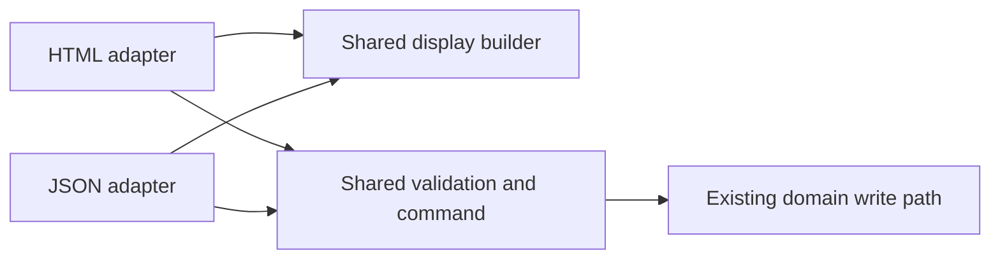

# Incremental React in N26

N26 keeps Django routes and shared page shells. React owns an independent
interaction or a complete workflow's page body. A workflow is one user task,
including its reads, commands, confirmations and failure paths. Cotton continues
to render the surrounding shell. React regions are client-rendered, not hydrated
or server-rendered.

The next migration unit is a complete workflow with explicit display data and
command endpoints. Start with Manage credits, then Hire and Equip. Keep small
islands for interactions that already have an independent owner. Build each
workflow's endpoints with its React consumer; do not start a separate API rewrite.

## Workflow migration plan

The goals are incremental delivery, a repeatable implementation, preserved
behaviour and one UI owner per task. Old and new pages can coexist through normal
navigation. A migrated workflow must not depend on Alpine state or htmx swaps
inside its React root. Shared navigation outside that root can remain unchanged.

### Establish parity before changing the renderer

For the chosen task, list its entry points, permitted users, inputs, choices,
defaults, confirmations, writes, failure states and navigation destinations.
Include empty states, private and public variants, query parameters and every
figure a write updates. Record this contract in the PR description and protect
it with tests.
Changing wording is part of the migration; changing domain rules or removing a
variant requires a separate product decision.

N26 already has useful boundaries, but a view is not automatically ready to become
an API. [Operations](../../n26/core/operations.py) own player-data writes,
[forms](../../n26/core/forms.py) validate inputs, and
[render structures](../../n26/core/render.py) prepare display facts. Some workflow
decisions still live in views:

- [Manage credits](../../n26/core/views/credits.py) combines permission checks,
  form validation, the locked write, errors, analytics and return navigation.
- [Hire](../../n26/core/views/hire.py) also resolves offered profiles, option
  picks, quotes and confirmation state before calling the hire operation.
- [Equip](../../n26/core/views/equip.py) combines purchase preparation,
  confirmations and several HTML updates after a write.

Calling the same operation from two endpoints is necessary but does not preserve
all that behaviour. Before adding another transport, extract the workflow
decisions that both callers need into the owning Python module. Keep the
extraction limited to this task; do not create a generic service framework.

The HTML and JSON adapters must share:

- authorised object lookups, valid choices and the permission recheck under the
  operation's lock;
- input validation, selection resolution, quote calculation and confirmation
  requirements;
- one command implementation using `operation(...)` for player-data writes,
  including ledger changes and other domain side effects; authoring workflows
  retain their existing content-write path;
- display preparation, error meaning and the result needed for analytics and
  user feedback.

HTTP adapters parse requests and turn the shared result into HTML, JSON or a
redirect. Keep request-specific message and analytics handling there, with each
event recorded once for a newly committed action. Do not call one view from
another or pass an HTTP request into domain operations. A command result can be
a small typed structure containing the changed records or required confirmation.



Use one display builder for the initial page props and subsequent JSON reads.
Serialise the authorised display fields explicitly; a model or dataclass dump
can include private or non-JSON values. Embed initial props through `react_island`
instead of fetching them again after mount. Add a read endpoint when a consumer
needs a refresh or lazy data, rather than for endpoint symmetry.

Test the shared behaviour and both adapters while both transports have callers.
Run equivalent scenarios against independent, equivalent fixtures; do not apply
both commands sequentially to the same gang and compare the results. Compare
allowed actions, error fields, changed records, ledger events, totals and
destinations. Assert no writes after validation or permission failures. HTML
redirects and JSON status codes can differ deliberately; test the documented
response for each transport. Copy edits need not retain old sentence text, but
must preserve the error's meaning and applicable action.

### Build the first complete workflow

1. **Manage credits:** extract its shared access, validation and command path.
   Add the display contract and JSON command, then replace the complete form
   body with one React root. Preserve owner and arbitrator access, current
   balance on refusal, safe return navigation, analytics and success feedback.
2. **Independent edit forms:** use Edit campaign holding, then Edit campaign
   asset type to prove the shared form primitives and conflict handling for
   absolute edits. These complete tasks need no catalogue or model-card renderer.
3. **Hire:** prepare the catalogue and lazy model-preview contracts, including
   safe rich-text display where needed. Migrate filters, option picks, preview,
   name and price confirmation, submission and onward navigation together.
4. **Equip:** reuse the catalogue support. Include owned assignments, price
   drafts, buy and sell confirmations, and updated holdings, credits and cards.
   Return display data for React-owned content instead of out-of-band HTML.

These steps define the migration order. Confirm each workflow's contract before
implementing it. Manage credits establishes the endpoint and error conventions;
its value is the repeatable pattern. More complex workflows may need preparatory
component or extraction PRs. Each prerequisite must have a named consumer and its
own verification.

With the first workflow command, establish a small shared request and error
convention using a real caller. Put generic transport helpers in `n26/frontend/http/`, the
planned location described in [frontend instructions](../../n26/frontend/AGENTS.md).
Keep workflow-specific response interpretation in the island. Cover session
expiry, CSRF failure, field and non-field errors, stale reads, network failure
and pending state. Distinguish a rejected
write from a request whose outcome is unknown. Disable duplicate submissions,
and implement server request-key handling where retries could spend or grant
twice. A disabled button is not idempotency. Existing keyed action flows are
examples; `adjust_credits` needs an explicit retry design before promising one.

Keep forms and domain rules authoritative on the server. Form-encoded input can
reuse Django forms; JSON responses do not require JSON request bodies. Return
fresh display facts or a server-validated navigation destination after a command.
Do not introduce optimistic money updates, cross-route client caches or a
client-side router to migrate the first page.

### Review copy and comments in every migration

Load the [microcopy skill](../../.agents/skills/microcopy/SKILL.md) and apply a
plain-English review to the migrated workflow, including text copied unchanged
into TSX or endpoint responses. Review headings, labels, help, confirmations,
empty states, success messages, validation errors and permission refusals.
Keep domain terms, interpolation values and the meaning of each instruction.
When Python defines a shared string, update it there so HTML and JSON use the
same wording.

Review comments in the migrated implementation and shared code changed by the
extraction. Remove comments that repeat the code. Rewrite metaphors,
personification and compressed prose as direct statements of the constraint or
reason. Keep useful invariants; remove ticket history, attribution, abandoned
approaches and temporary agent notes. Follow [N26's comment rules](../../n26/AGENTS.md#comments).
Do not sweep unrelated files or rewrite stored user content or authored library
content. A framework migration does not authorise changing terminology or rules.

Run `scripts/check_microcopy.py` on changed files through the worktree's Python
wrapper. Review its warnings; the checker cannot replace a cold read of copy and
comments. Have an independent reader review the migrated text when delegation is
available. Include a short copy and comment review result in the PR, alongside any
deliberately retained wording and its reason.

### Verify and switch the whole workflow

A workflow is ready to switch when:

- every variant and failure path in its contract works through the new UI;
- shared behaviour and adapter tests cover permissions, validation, side effects,
  concurrency, duplicate requests and safe navigation as applicable;
- React tests cover state, forms, pending/error recovery and keyboard/focus
  behaviour, including Back/Forward for URL state;
- real-page checks cover phone and desktop widths, both themes, visual parity
  and useful screenshot or interaction evidence;
- SQL and query-growth checks pass, and loading with and without cached assets
  shows no unexplained regression in representative data, payload size or preview
  loading;
- copy and comments have been reviewed, and obsolete code has been identified
  against all callers.

Use the [testing guidance](testing.md), [SQL performance skill](../../.agents/skills/sql-performance/SKILL.md)
and [visual evidence skill](../../.agents/skills/pr-screenshots/SKILL.md). Run the
focused Python tests, React tests, typecheck and production build before cutover.
Keep existing domain checks; a new rendering test does not replace them.

Select one complete renderer for each request. During a short rollback period,
both renderers can call the same Python behaviour, but never mount both and hide
one. Name the removal follow-up if it cannot be included in the cutover PR. Delete
the old page implementation and bridges after verification; retain endpoints or
components still used by other workflows. Lower the Alpine baseline where it
actually falls. A page can be worth migrating even when the baseline records no
Alpine usage.

### Choose migration scope during ordinary work

Use React for new N26 interactions. When changing an existing interactive task,
identify its complete workflow before choosing a component boundary. Migrate it
by default when the required extraction, endpoints, components and verification
fit the requested change. An existing server endpoint is not a prerequisite:
task-specific endpoints and a bounded behaviour extraction are part of a
migration. Do not add a permanent event bridge merely to keep the diff smaller.

For each touched interactive workflow, report one outcome: already React,
migrated, or deferred with a concrete reason. Reviewers should request this
assessment when it is missing. A vague statement that a page is complex or needs
an API is not a deferral reason.

### When to defer a migration

Do not enlarge a task into a migration when:

- it is a copy-only, static, backend-only or urgent corrective change whose
  scope cannot include the workflow and its checks;
- it would require an unresolved product decision, domain-rule change or
  unrelated schema/data work;
- a necessary display contract or complex primitive is not available and cannot
  be implemented and verified within this task;
- an active change overlaps the workflow, or representative data, access or
  services needed to prove parity are unavailable;
- it crosses N23, print layouts or several independent workflows without an
  explicit request for that scope.

Finish the authorised fix using the existing architecture. Do not add new Alpine
to work around a missing React capability. Record the exact dependency, the
affected workflow and the smallest verifiable preparation step. For a dedicated
migration task, implement that preparation when it is in scope and independently
useful; otherwise report the blocker. Do not remove behaviour, weaken checks or
leave a placeholder to make a migration appear complete.

## Diagnosis

The migration's hard part is shared ownership, not installing React:

- N26's design system is Tailwind, CSS tokens and Cotton templates, including an
  installed `django-cotton-ui` kit. React cannot render Cotton tags: they are
  Django compiler input, not browser components. A separately styled React kit
  would drift from the existing pages.
- Alpine behaviour is spread across pages, first-party primitives and the
  installed kit. Removing its script now would break menus, navigation and theme
  controls even on a page whose main interaction has migrated.
- htmx can replace a fragment containing a React root. Without a lifecycle
  boundary, that replacement can leave subscriptions alive or give both
  systems ownership of the same DOM.
- Django already prepares display structures and owns domain operations. A broad
  API rewrite would add work before the first useful React component appears.
- Agent instructions and review guidance must name the complete workflow as a
  migration unit. Restricting agents to small controls with existing endpoints
  leaves connected player workflows outside the migration queue.
- Production uses Django manifest staticfiles and WhiteNoise. Vite also hashes
  assets. Giving a shared module two URLs can load two React instances; loading
  a cached document's deleted chunk can leave a blank region after a deployment.

## Decisions

| Question | Decision | Consequence |
| --- | --- | --- |
| Replace htmx with an API layer? | Add workflow display and command contracts with their React consumers. | Keep htmx outside migrated roots. Reuse forms and operations; normal links remain the boundary between tasks. |
| Load React everywhere? | Yes, in N26: the bar's quick switcher is an island, so every page with the bar loads React. Other islands still load only where a template includes them. | The shared React chunk (about 68 kB gzip) is cached as an immutable asset; each full navigation still parses and runs it. |
| Minimise bootstrap cost? | One shared cached React chunk, small per-component entries, modulepreload, embedded initial props. | No initial data-fetch waterfall, duplicate runtime or framework/router dependency. |
| Pass initial state? | A plain JSON-safe view model through `react_island` and Django `json_script`. | Safe escaping, no executable inline state, no ORM objects or hidden permission assumptions. |
| Reuse the design system? | Generate presentation recipes from real rendered Cotton primitives at build time; implement their behaviour in typed React adapters. | The actual Cotton classes and app tokens stay authoritative. Only supported variants cross the bridge. |
| What migrates next? | Manage credits, then Hire and Equip as complete workflows. | Prove shared behaviour and endpoint conventions on a small task before connected catalogues. Existing independent islands remain valid. |

### DOM and state ownership

The template tag emits an empty host, an inert JSON script, modulepreloads and a
small module loader. `…` is the same host with
server-rendered markup inside it instead of a loading box, for a control that
holds its place in a bar: the page shows that markup until React mounts and
replaces it, and a reader without JavaScript sees only that markup. `x-ignore` and `hx-disable` prevent Alpine and htmx from
processing the host's children. An entry exports `mount(element, props)` and
returns a disposer. The loader mounts each host once, including a host inserted
after the first paint (an Alpine `x-if` disclosure, for example), handles
`htmx:load`, and unmounts the root when htmx or that insertion removes it,
including cancellation during an outstanding module import. Each root gets its
own React ID prefix.

The host's `data-react-name` is the kebab-case island name passed to the tag.
`data-react-module` is the content-addressed file URL, so a selector such as
`[data-react-module*='/pick-list-']` matches a hash, not a stable id. In Django
tests and Playwright, select `[data-react-name="campaign-asset-selection"]`,
then read the JSON script whose id is the host's `data-react-props`.

React owns everything inside its host. Django owns the host and surrounding
page. Do not nest islands, pass live Cotton DOM as React children, or swap part
of a React root with htmx. Compose React children inside one root when they need
shared state. Independent widgets can have separate roots without a global store.

A Cotton component often takes content as markup: a slot of nested controls, or
a figure written into a named slot. React cannot own markup the server drew, so
when such a component moves to React, that content becomes typed props. Python
builds it (a dataclass per row, say: name, value, label, ticked, a price as
text) and the island draws it, as `ActionMenu` draws its `Action` links and
`<c-n26.checkbox-card>` draws its `CheckboxCardItem` ticks. When the host needs
a fallback, Cotton draws it from the same props, and the island mounts over it.
Do not detach server-drawn nodes into a React tree, reach out of the root to
toggle them, or keep the old implementation for the awkward variant. A
migration keeps behaviour: if a caller's content cannot yet be described as
data, say so in the PR and ask before changing what that caller does.

Page identity and state people should share or restore belong in the URL:
server-backed filters, meaningful tabs and form variants. Use normal navigation
first; an island that changes them with the History API must also handle
Back/Forward. Search over already loaded rows, temporary selection, open menus,
focus and unsaved drafts can live in React. Permission decisions, prices and
calculated domain totals remain server-owned.

No-JS rendering is deliberately not required for a migrated region. Its host
shows a loading status; module or render failures offer a page reload, and
`noscript` explains the requirement. The rest of the page remains Django HTML.

### Design-system bridge

`n26/frontend/tooling/export_cotton_recipes.py` renders fixed examples through
the real Cotton compiler, checks their element structure, and extracts their
classes and icon geometry. `ui/` applies those recipes to ordinary React
elements. It does not
evaluate Alpine, inject HTML or transpile arbitrary templates. Generated recipes
and bundles are ignored by git; CI, Docker and the development command build
them with the installed Python and npm dependencies.

The first adapters cover buttons, links, tables, the staged badge, action bars,
search and a checkbox filter menu. Unsupported options are not a hidden second
implementation: add a recipe and a typed adapter when a real caller needs one.
Changes to the extracted element sequence fail the build; nesting and extra
wrappers still require visual review. For rich
primitives such as a combobox or dialog, share the visual recipe but implement
keyboard, focus and selection behaviour in React, with tests. Do not copy the
kit's Alpine attributes and expect them to work.

`ActionMenu` is the first such menu. It draws a menu whose items are all links,
using the kit dropdown's panel, item and separator classes, and implements the
WAI-ARIA menu button pattern in React: arrow keys, Home and End, Escape back to
the button, and Tab out. Templates use it through `<c-n26.action-menu>`, which
takes `Action` links or a `` list. Python decides each item's
order, tone and whether a separator sits above it; the island only draws them.
The wrapper renders the same button as the island until it mounts, so the row
does not move, and its `:scriptless` option adds a `<noscript>` list of the
links. `c-ui.dropdown` stays for menus with button or `hx-get` items, groups,
shortcuts or other composite content.

`MenuButton` is the same menu button pattern over mixed rows: `MenuLink`,
`MenuSubmit` (a posting row), `MenuSeparator`, `MenuGroup` and radio rows such
as `ThemeChoice`. The arrow keys move over every row with a menu-item role. The
account menu is built this way: `` gives the bar's
`<c-n26.site.nav :account=…>` an ordered list of entries, and the account-menu
island draws them. A shell that wants a different menu builds different entries;
the platform's account pages pass `compact=True`.

`UserLink` draws a person's name with their badge, as `<c-n26.user-link
tone="current">` does. A badge's artwork is SVG markup, which an island cannot
take, so `n26.core.people.person_link` asks the platform which badge a person
shows and `n26/badges.py` turns its artwork into an element tree limited to the
platform's SVG allowlist. Props carry each badge once, keyed, however many rows
name its holder, and the browser checks the same allowlist again before drawing.

Both renderers use `designsystem/app.css`, the same typography, spacing, colours,
dark-mode class and CSS tokens. Tailwind scans the React source and generated
recipes. No new theme provider or CSS reset is introduced. The loader currently
supports JavaScript-only entries; do not import per-island stylesheets.

### Sortable tables

`SortableTable` in `n26/frontend/ui/` is the controlled table used by campaign
gangs and territory inventories. It renders sort and group controls, clickable
column headers, accessible sort direction, group headings and a live status.
Callers prepare the rows and groups, supply a row renderer, and handle view
changes and URLs. Keep permissions and domain calculations on the server.

`<c-n26.sortable-table :table="props" />` wraps the same component for plain
text and numeric cells with local selections. Its gallery example documents
the JSON shape. Richer tables mount their own island and import `SortableTable`
from the public `ui` boundary; they do not import another island.

### Server interactions

The authoring-list proof of concept uses existing links and a GET form. Workflow
migrations add their own display and command endpoints when asynchronous behaviour
needs them; follow the shared-behaviour and parity steps above.

For asynchronous reads or writes, add an endpoint beside the owning view:

1. Authenticate and check object-scoped permissions on every request; filter
   lookups to records that user may access.
2. Validate with existing forms/domain validation and call the same operation
   used by the HTML flow. Keep transactions and audit records there.
3. Return explicit display data on success and field/non-field errors on
   validation failure. Do not return ORM dumps, trusted HTML or raw exceptions.
4. Use same-origin session credentials and Django's CSRF token for unsafe
   requests. Preserve normal 401/403/404 behaviour; show session-expiry and
   network errors in the region. Do not disable CSRF to make `fetch` work.
5. Disable duplicate submissions while pending. Use server concurrency checks
   and idempotency where duplicate domain actions would spend or grant things;
   client button state is not a transaction guarantee.

Do not introduce a generic REST CRUD layer, duplicate domain logic in TypeScript
or replace unrelated htmx routes. Build shared request and error handling from a real
command consumer; local list filters need no API scaffolding.

### Assets and cost

`npm run build` exports Cotton recipes, builds production Vite entries, then
builds CSS. `npm run js` is enough for Django tests that need the island
manifest. `npm run js:dev` selects React's development runtime and emits
unminified local assets with source maps, so source component names remain
visible in React DevTools. `./scripts/dev.sh` runs that development build before
serving and watches frontend changes with the same mode.

After rebasing an older worktree onto a branch that added or changed the React
islands, install from the lockfile and rebuild the gitignored manifest with the
worktree venv on PATH:

```bash
npm ci --no-audit --no-fund
PATH="$PWD/.venv/bin:$PATH" npm run js
```

`.codex/run.sh` does both when `node_modules` or the manifest is missing or
stale. If island, Cotton, or icon sources contain Git conflict markers,
`.codex/run.sh` skips that rebuild and the command you asked for still runs.
`npm run js` starts a Python exporter, so a bare `npm run js` without the
venv fails. Do not run `npm audit fix` unless the task is the audit itself.

Vite owns the content-hashed filenames under `n26/react/assets/`. That output
lives in the gitignored directory `n26/core/static/n26/react/`. setuptools
package discovery excludes `n26.core.static.n26.react*`,
`n26.frontend.generated*`, `node_modules*`, `staticfiles*`, and `logs*`.
Without that exclude, the editable install records every directory it finds,
including the Vite tree, and a later `uv sync` still names the assets
directory after a rebase has removed it. The template
uses those exact URLs and preloads their static imports. The ordinary bootstrap
script still uses Django's `static` tag. WhiteNoise marks Vite assets immutable;
`collectstatic` must keep the original Vite-named files, not only Django's
second-hashed copies. Do not enable `WHITENOISE_KEEP_ONLY_HASHED_FILES` without
changing that integration.

The first production build is about 68 kB gzip of shared React/React DOM and
3 kB gzip for the authoring-list entry, plus a small loader. These are measured
build sizes, not a mobile performance score. React still parses and executes on
each full page navigation, even with a warm cache. Alpine and the kit remain
loaded for unconverted chrome, so the transition temporarily carries both.
Avoid mounting React for static content or adding a router/state library.

Eagerly preload visible islands; do not put their first interaction behind an
intersection observer. Defer substantial below-fold tools only after measuring
the page. Preserve sensible loading space to limit layout shift. Large datasets
eventually need server pagination/search; React is not a reason to send every
record. Keep the previous deployment's hashed assets available during rollout
where the hosting setup permits it. If a stale page requests a removed chunk,
the loader's reload affordance is the recovery path, not a silent blank region.

## The proof of concept

`/n26/design/react/` is a staff-only, database-free demo. It compares Cotton and
React tables using the same sample content, offers live filtering, and prints the
actual template and React entry used to embed the component. Use the gallery's
theme control to compare both renderers in light and dark mode.

`/n26/authoring/weapon/` is a working example. All populated leaf-list pages use
the same `AuthoringList` component; the heading, help and New action stay Cotton.
An empty list stays Cotton and loads no React.

React replaces the list's Alpine search and bulk selection. It preserves name
links, qualifiers outside links, prices, author notes and staged markers. Search
uses the server's prepared search text. Select-all applies to shown rows, has an
indeterminate state, and does not discard selections hidden by a later filter.
Hidden inputs submit the selected IDs to the existing bulk-attach GET route.
No authoring operation or database schema changes.

`/n26/authoring/modifiers/` is the second working migration. Its populated list
uses a separate `modifier-list` island for search, scope/effect/carried facets,
the count and the table; the page header and empty state remain Cotton. The
filters narrow the complete set already embedded by Django, so their state stays
transient just as it was under Alpine. The shared `FilterMenu` adapter renders
the Cotton component's extracted presentation while React owns its popup,
checkbox, Apply, Cancel, outside-click and keyboard behaviour.

The leaf-list source path is:
`library.views.leaf` → `authoring/leaf.html` → `react_island` →
`islands/authoring-list/entry.tsx` → `AuthoringList.tsx` → `ui/`.

The modifier-list source path is:
`library.views.modifiers` → `authoring/modifiers.html` → `react_island` →
`islands/modifier-list/entry.tsx` → `ModifierList.tsx` → `ui/`.

Frontend source separates feature code from shared infrastructure. Feature code
is co-located under
`islands/<name>/`; generic mounting belongs in `runtime/`; Cotton-derived React
primitives form the public `ui/` boundary. Generic JSON transport belongs in
`http/` when the first workflow introduces it; Django-aware build code stays in
`tooling/`. The ignored `generated/` directory is output, never an authoring
surface. The repository-root TypeScript, Vite and Vitest configs are shared by
all islands beside the single root `package.json`; do not create per-island
configs. `n26/frontend/AGENTS.md` is the concise directory-level reference.

The Django view prepares ordinary display data, including server-generated URLs:

```python
authoring_list = {
    "rows": [{**row, "pk": str(row["pk"])} for row in rows],
    "pluralLabel": "weapons",
    "bulkActionUrl": reverse("authoring-attach-modifier", args=["weapon"]),
}
```

The template embeds it where the interaction belongs:

```django


```

The entry mounts the component with the shared lifecycle and error boundary:

```tsx
import { mount as mountRoot } from "../../runtime/mount";
import { AuthoringList, type AuthoringListProps } from "./AuthoringList";

export function mount(element: HTMLElement, props: AuthoringListProps) {
    return mountRoot(element, AuthoringList, props);
}
```

Python tests cover initial data and existing view contracts; React tests cover
rendered behaviour and safe text handling. The actual worktree page should also
be checked with realistic data, keyboard selection, phone width and dark mode.
Keep database query-growth assertions: client rendering cannot fix N+1 queries.

## Agent instructions and migration inventory

Root and N26 `AGENTS.md`, the `n26-react` skill and Copilot instructions carry the
workflow migration default. This document defines the detailed plan, parity
requirements and deferral criteria. Keep those entry points aligned when the
migration policy changes. The Alpine guard detects new directives; it cannot
judge workflow completeness, copy quality or shared domain behaviour.

### The Alpine baseline

`n26/frontend/tooling/alpine-baseline.json` gives each N26 template two
ceilings:

- **direct**: Alpine written in the template. That is `x-*` and `@event` on any
  tag, `:attr` on HTML tags, and `::attr` on Cotton tags, which Cotton renders
  as `:attr`. `:attr` on a Cotton tag is a Python expression, so it is not
  counted.
- **kit**: Alpine that `<c-ui.*>` kit components add to the page. Each use is
  charged the component's weight: the Alpine in its template plus the kit tags
  it nests, counting only the largest `` branch. Weights come from the
  installed `django_cotton_ui` templates, or from the override in
  `n26/core/templates/cotton/ui/` when there is one.

Moving a menu to React lowers the kit column even when the template had no
Alpine of its own. Replacing hand-written Alpine with a new `<c-ui.dropdown>`
still fails, because the kit ceiling is per template too. Tooltips and tabs
are charged like any other kit component.

Two things are not charged in the kit column:

- page chrome (`ui.breadcrumbs`, `ui.alert`, `ui.avatar`), up to the cap for
  each tag in `UNCHARGED_TAGS`;
- kit tags in the design-system gallery, `n26/designsystem/`. The gallery's
  direct Alpine still counts.

Counts are per file. A component that repeats on a page counts once, and
`` is not followed.

**Kit upgrades.** The baseline also records each kit tag's weight. When a
`django_cotton_ui` upgrade changes a weight, the check fails and names the
change, for example `ui.dropdown 13→15`. Review the change, then run
`--update`. `--update` accepts new weights, but it still fails when a template
has more direct Alpine or more kit tag uses. The first use of a kit tag with no
recorded weight also needs `--update`, so its weight is in the baseline before
an upgrade can change it. A kit tag with no template also fails the run, so a
renamed component cannot quietly drop to 0.

An override in `n26/core/templates/cotton/ui/` is a first-party template with
its own ceilings. Adding Alpine to one fails as new direct Alpine, even with
`--update`. Removing Alpine from one lowers its weight, which `--update`
records.

### Removing old runtimes

Remove Alpine only after inventorying first-party templates, installed-kit
components and all page shells. An empty baseline alone is insufficient because
the baseline excludes Alpine from page chrome and kit components used in the
gallery. Remove htmx independently when no remaining consumers need HTML swaps.
Track completed workflows, remaining callers, parity checks, loading with and
without cached assets, visual defects and deleted directives.

## Optional scheduled migration

The prompt below describes the workflow migration job. Changing this document
does not install or update a live automation. An operator must apply the prompt
to its configuration separately. Keep at most one unmerged automated migration
PR; the job must not merge or deploy.

> Read repository instructions, `docs/developing-gyrinx/react.md` and the
> `n26-react` and microcopy skills. Check for an open automated migration PR and
> overlapping active work before choosing a task. Take the next ready workflow
> from the documented sequence, starting with Manage credits if it has not
> migrated. Use the Alpine inventory to find callers, not as the only queue.
>
> Define the complete task: permitted users, inputs, defaults, confirmations, writes,
> errors and navigation. Add or reuse tests that describe those behaviours.
> Inspect the HTML view and every existing endpoint before adding a transport.
> Extract the shared workflow behaviour where needed, retaining existing forms,
> permission checks, operations and side effects. Add narrowly scoped display
> and command contracts with their consumer; new endpoints are allowed. Do not
> duplicate business logic or introduce a generic CRUD layer.
>
> Give the workflow one React owner using the existing runtime and design
> adapters. Keep independent shared chrome outside it. Do not use Alpine state,
> htmx child swaps, nested islands or server HTML inside the migrated root.
> Preserve URL state, all variants, errors and safe navigation. Review every
> migrated user-facing string and comment, including copied text. Apply the
> microcopy and plain-English rules without changing domain meaning.
>
> Follow the parity, copy, SQL, visual and build checks in the plan. Select one
> renderer for the whole task, remove obsolete code after checking its callers,
> and lower the Alpine baseline where applicable. Open one reviewable PR with
> the workflow contract, shared-behaviour evidence, test results, copy and comment
> review and useful visual evidence. State any retained caller or cleanup work.
>
> Apply the documented deferral criteria. If a required preparation step is in
> scope and independently verifiable, implement it as a focused prerequisite
> with a named workflow consumer. Otherwise report the exact blocker and next
> step. Do not substitute a placeholder, remove behaviour, change domain rules,
> merge, deploy or work around missing access.

## Framework references

React explicitly supports [multiple roots in partially React pages and unmounting
roots removed by other systems](https://react.dev/reference/react-dom/client/createRoot).
Vite documents [backend integration through its build manifest and modulepreload
graph](https://vite.dev/guide/backend-integration). This implementation keeps that
integration inside Django; it does not require a separate application server.

### Manage credits command example

Manage credits uses `n26/core/credits.py` for access, form validation, the locked
permission check and the adjustment. Its HTML POST and JSON command adapters
share that function. The page embeds its initial display props; it has no extra
GET API. `manage-credits` owns the complete form body, while Django keeps the
route and shared navigation.

The command accepts form-encoded `direction`, `amount`, `note`, `back` and
`request_key`. It returns `200` with a validated `nextUrl`, `422` with field or
`__all__` errors and the current balance, or `409` for conflicting key reuse.
Authentication and CSRF failures return `401` and `403`. Access failures remain
`404`. The shared CSRF handler returns JSON only for an explicit
`Accept: application/json`; native form failures retain their redirect.

A successful credits adjustment stores its request key on its ledger event,
with a database uniqueness constraint per gang. Under the gang lock, the command
checks current access and compares a replay's actor, direction, amount and note
with the recorded adjustment. Matching replays succeed without another event;
a different payload is rejected. Failed adjustments do not consume the key.
Analytics run after commit, only for a new adjustment. Unread success feedback
is deduplicated by request key. If it was already consumed, a replay confirms
that the adjustment was already saved instead of announcing another adjustment.

Use `n26/frontend/http/command.ts` for the transport. Keep response interpretation
in the workflow. A network error, a server error or an unreadable success response
leaves the write uncertain. Retain the exact submitted payload and key, freeze
editing and offer a retry of that save. A rejected retry does not resolve an
earlier uncertain write. Warn before leaving during pending or uncertain saves;
clear that warning before confirmed-success navigation. Do not mint another key
and let the user submit edited values while the earlier write is unresolved.
This also applies to structured validation or permission refusals on retry:
they describe that request, not an earlier request's outcome. Only a confirmed
matching success resolves an uncertain credits save.

Keep unresolved command input in session storage, scoped to the actor and
workflow, before sending the request. Restore it after reload with the same key
and business values, but use the fresh page's CSRF token. Do not persist session
credentials or CSRF tokens. This allows recovery after signing in again, which
rotates the CSRF secret. Clear recovery input after a confirmed result; if it
cannot be retained, do not start a write that the page cannot safely recover.

React workflow forms use `data-busy="off"` to opt out of the shared
`n26/core/static/n26/busy.js` DOM mutations. React owns pending state, including
links. If a reader cancels a navigation warning, the shared handler would
otherwise leave the link disabled without a new page to clear it.

Test Back after a successful command. Manage credits returns its HTML with
`never_cache`, and refreshes a completed form restored from the browser's
back-forward cache. That obtains a fresh balance and request key for a new
adjustment. Also refresh an older cached draft when recovery storage now holds an
unresolved command from a later form. Read storage at restoration time, not only
at mount, so the older draft cannot overwrite that command. Preserve an unsaved
draft only when no command needs recovery.

The single-event receipt suits credits adjustments. A workflow producing several
events must identify one durable command receipt and its canonical payload;
do not assume an operation's grouping `batch` is unique. Prove simultaneous
retries, lost responses, conflicting payloads, rollback, locked access checks and
feedback before reusing this pattern for another write.

### Absolute edits: Edit campaign holding

`n26/core/asset_edit.py` shares the holding form, signed starting snapshot and
locked command between native POST and the JSON command. The existing campaign
operation still changes the name and income override. Blank income and `0`
remain distinct, and replacing an override affects only that holding.

Absolute edits need a different retry contract from credit adjustments. The
signed snapshot identifies the actor, holding, starting values and modification
time. Under the campaign lock, a submission matching current values succeeds
without another write. Different values can be saved only from the same starting
state; a stale snapshot returns `409` with `code: revision_conflict`, current
name/income and no write. The comparison includes nested income values as well
as the holding's modification time.

Keep the conflicting draft visible and frozen. Show the current facts and offer
**Review current asset**, which explicitly discards the retained draft and loads
a fresh form. Do not silently replace its snapshot or add a save-anyway action.
An older pending request cannot overwrite the reviewed edit: under the same
lock it either matches current values and does nothing, or its revision is stale.
Generic network, authentication and validation failures do not prove this and
must retain an earlier uncertain submission.

Bind failure metadata to the command it describes. When session storage contains
a retained command, native POST errors or conflict props may concern an older
submission. Restore the retained command and retry it before accepting those
facts or offering an action that discards it.

The holding form reuses the page, fields, currency suffix and HTTP transport from
Manage credits. Keep its response interpretation local. Extract common form
recovery behaviour once a third real consumer establishes the shared contract;
the absolute-edit conflict decision must remain owned by its workflow.
